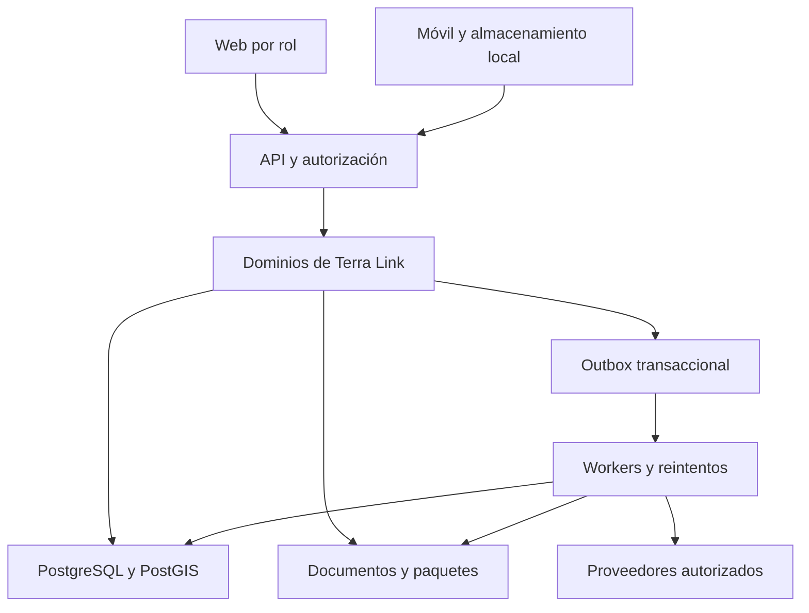

# Arquitectura técnica objetivo

FUENTE: S1 §§5–8, 40, 54, 75–84. PROPUESTA: límites, outbox y adaptación al código existente.

## Decisión de base

Monolito modular por dominio, PostgreSQL/PostGIS, almacenamiento compatible con S3, Redis y workers. Web y móvil son clientes independientes de la API; el navegador no se conecta directamente a la base. El monolito puede desplegar API y worker por separado con el mismo dominio compartido.

## Stack: condición de selección

| Componente | Fuente inicial | Tratamiento para Terra Link existente |
| --- | --- | --- |
| API | TypeScript/NestJS | Mantener FastAPI si se confirma en repo; no introducir dos backends |
| Web | React/Next.js/TypeScript | Mantener React y router/build existentes si se confirman |
| Mobile | React Native/Expo/SQLite | Comprobar implementación y compatibilidad real antes de elegir |
| Base | PostgreSQL/PostGIS | Mantener motor y versión detectados, con migraciones |
| Cola | BullMQ/Redis | BullMQ solo si backend compatible; en Python adoptar librería del repo o ADR |
| Objetos | S3 compatible | MinIO local si ya existe; proveedor real vía configuración |
| Mapa | MapLibre/capas compatibles | Mantener librería GIS confirmada |
| Identidad | OIDC/OAuth2 compatible | Reutilizar proveedor/auth actual y plan de integración |

No se fijan versiones sin manifiestos. Para un repositorio nuevo, ADR-0001 debe comparar opciones y establecer un único stack, lockfiles y comandos ejecutables.

## Límites de módulos

| Módulo | Propiedad del dato | Dependencias permitidas |
| --- | --- | --- |
| identity/organizations | Membresías, roles, tenant | Contratos de auditoría |
| producers | Productores y pertenencia | Organización |
| plots/GIS | Parcela y versiones geométricas | Productor, GIS adapter |
| products/quality | Estados del cacao y mediciones | Catálogos, recepción/lote |
| traceability | CTE, KDE y relaciones causales | Contratos de dominios de operaciones |
| inventory/lots/processing | Ledger, asignación, transformación | Entrega/recepción y catálogo |
| documents/evidence | Objeto, versiones y afirmaciones | Referencias autorizadas de entidades |
| risk/legal | Reglas y evaluaciones | Snapshots de GIS/evidencia/cadena |
| due-diligence | Expediente y paquete | Evaluación, mitigaciones, evidencias |
| shipments | Embarque y preflight | Lotes, calidad, expediente |
| integrations | Adaptadores y jobs externos | Contratos del dominio |
| audit/reporting/notifications | Historial, vistas y avisos | Eventos y proyecciones autorizadas |

Cada módulo separa dominio, casos de uso, persistencia/adaptadores y API. La estructura física se mapea al repositorio real; no se impone una reubicación masiva para adoptar nombres de este documento. Evitar que un módulo modifique las tablas de otro al margen de sus casos de uso.

## Consistencia

Mutación de negocio, ledger/evento, auditoría y outbox se guardan en la misma transacción cuando comparten base. El worker entrega al menos una vez; cada consumidor deduplica. La cola no es el historial definitivo. Un error de satélite no revierte una entrega aceptada ni se convierte en evidencia de bajo riesgo.

## Ejecución y superficie de seguridad

Entrada HTTPS, límites de payload, autenticar → seleccionar organización autorizada → validar permiso/recurso → ejecutar caso → registrar resultado. Los workers propagan tenant, actor original, correlation ID y versión objetivo. Caches incluyen tenant y alcance de permisos; exportaciones y descargas también autorizan.

## Artefactos de TECH-001

Mapa real de directorios/módulos; ERD ajustado; diccionario; matriz RBAC; catálogos CTE/KDE; envolvente de eventos; OpenAPI ejecutable validada; framework de reglas; ADR de stack y tenancy; comandos y CI reproducibles. Los documentos 05–13 son especificaciones de partida, no migraciones ni OpenAPI ejecutable ya instaladas.
