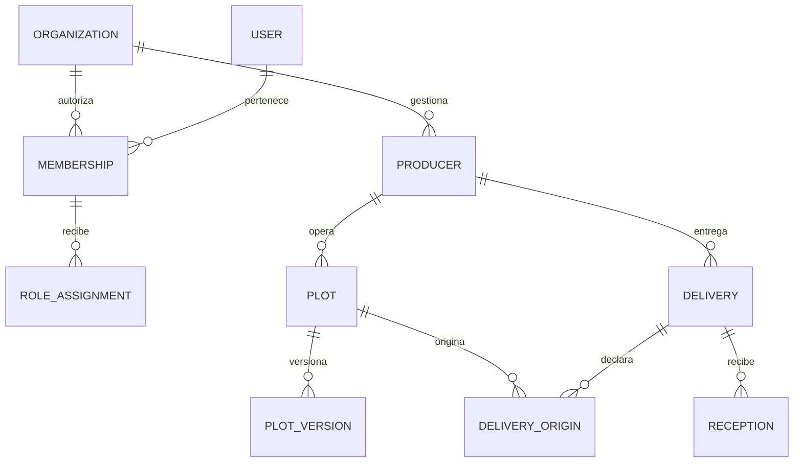
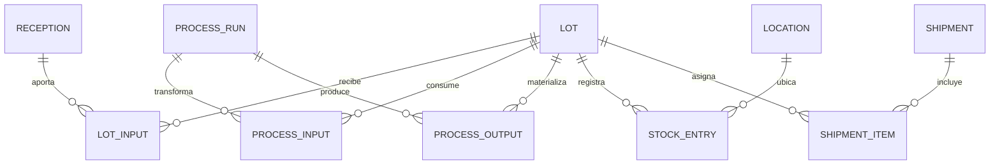
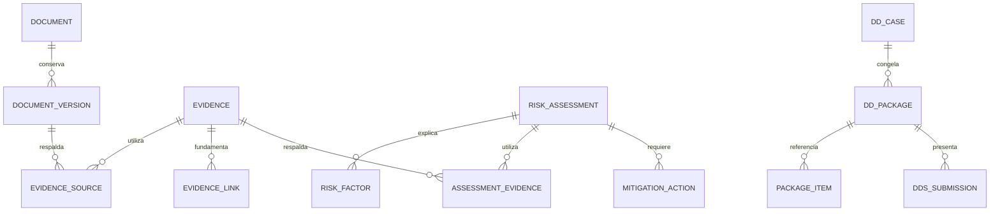

# Modelo de dominio y ERD lógico

FUENTE: S1 §§10–44 y S2 §15. PROPUESTA: recepción separada, ledger y snapshots versionados. Ajustar al esquema real; no crear tablas duplicadas por diferencias de nombres.

## Agregados e invariantes

| Agregado | Invariante |
| --- | --- |
| Organización/membresía | Un usuario actúa con membresía activa y alcance explícito |
| Productor | Código único por tenant; documento no es identificador público |
| Parcela | Propietario/operador y geometría versionados; no sobrescribir la utilizada en evaluación |
| Entrega | Origen, estado del producto, unidad, periodo y cantidad explícitos |
| Recepción | Cantidad declarada y recibida separadas; una recepción no crea doble stock |
| Lote | Entradas/salidas conservan procedencia; prohibir ciclos de ascendencia |
| Procesamiento | Entradas consumidas, salidas y merma registradas como una unidad atómica |
| Inventario | Saldos derivados del ledger y asignaciones; doble consumo bloqueado |
| Documento | Bytes y metadatos por versión; estado de escaneo separado de validación |
| Evidencia | Respalda una afirmación y señala fuente, versión, periodo y revisión |
| Riesgo | Evaluación reproducible con reglas, evidencia, geometría y datos de entrada |
| Expediente | Readiness sujeto a bloqueos; paquete fija versiones y revisión |
| Embarque | Cantidad asignada a lotes, comprador y destino; liberación con preflight |

## ERD: identidad y origen

Una entrega puede declarar varios orígenes solo si asigna cantidades y conserva todos los vínculos. Es una extensión propuesta del `plot_id` simple de S1; el MVP puede comenzar con una parcela por entrega. Origen parcial/unknown debe mantenerse explícito y bloquear preparación cuando aplique.

## ERD: custodia e inventario

Cada relación cantidad–origen representa una contribución del grafo. La atribución proporcional tras mezcla debe etiquetarse como cálculo, no identificación física de un grano. Todos los insumos deben ser conocidos y elegibles según la política aplicable; balance de masa no autoriza mezclar material de origen desconocido.

## ERD: evidencia y diligencia

`DDS_SUBMISSION` se usa solo cuando exista integración y presentación real; no se rellena por una descarga local.

## Integridad relacional

En todas las tablas operativas usar `organization_id NOT NULL`. Establecer unicidad `(organization_id, id)` y FK compuestas para referencias intraorganización o una alternativa equivalente probada. Un UUID válido de otro tenant nunca debe superar la validación. Los enlaces polimórficos no reciben una FK mágica: usar registro tipado de entidades o tablas de asociación con constraints/casos de uso; documentar elección en TECH-001.

Usuarios pueden ser globales con membresías múltiples; productores son entidades de negocio, no necesariamente usuarios con login. Identidad compartida entre organizaciones no implica acceso a historiales compartidos. Un catálogo global debe separarse de las instancias y permisos del tenant.

## Ciclos de vida propuestos

- Productor: `DRAFT → ACTIVE → INACTIVE`; baja lógica preserva historial.
- Geometría: `CAPTURED → VALIDATED / REVIEW_REQUIRED / INVALID`; revisión crea nueva versión si cambia.
- Recepción: `DRAFT → CONFIRMED → CORRECTED`; corrección crea ajuste, no reescribe el peso confirmado.
- Proceso: `DRAFT → RUNNING → CLOSED`; cambios posteriores mediante operación de corrección autorizada.
- Lote: disponibilidad, estado operativo, calidad y bloqueo de riesgo son dimensiones distintas. `CLOSED` no se interpreta como saldo cero.
- Mitigación: `OPEN → IN_PROGRESS → EVIDENCE_SUBMITTED → VERIFIED / REJECTED`; rechazo retorna al trabajo conservando revisión.

Nombres y transiciones son propuestas y se mapean a los enums reales antes de migrar. La matriz de diligencia está en el documento 13.
