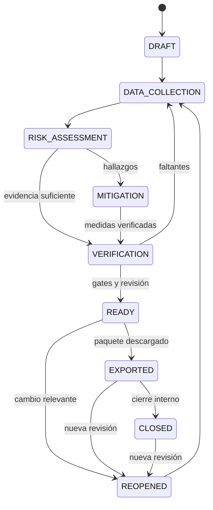

# Riesgo, legalidad y debida diligencia

FUENTE: S1 §§33–44, 82–85; S3 §§20–23, 35–39. PROPUESTA de ingeniería, no dictamen legal. Las guías nacionales referidas no se recibieron completas; validar requisitos aplicables contra fuente primaria vigente.

## Dimensiones separadas

| Dimensión | Valores propuestos | Interpretación |
| --- | --- | --- |
| Severidad | NOT_ASSESSED, LOW, MEDIUM, HIGH, CRITICAL | Resultado técnico explicable |
| Proceso de revisión | OPEN, UNDER_REVIEW, MITIGATION_REQUIRED, RESOLVED | Trabajo pendiente |
| Conclusión regulatoria | UNDETERMINED, NEGLIGIBLE, NON_NEGLIGIBLE | Solo bajo perfil jurídico y revisión autorizados |
| Readiness | BLOCKED, IN_PROGRESS, READY, STALE | Preparación de snapshot |

`LOW` no implica riesgo jurídicamente insignificante. `RESOLVED` puede significar que se investigó y rechazó el material, no que se volvió elegible. Score insuficiente es null/NOT_ASSESSED y genera acción de recopilación, no cero.

## Categorías

DEFORESTATION, LEGALITY, MIXING, SUPPLY_CHAIN, DOCUMENT_CREDIBILITY, TRACEABILITY, EVASION, HUMAN_RIGHTS, INDIGENOUS_RIGHTS y DATA_QUALITY. Cada factor conserva valor, método, peso si aplica, severidad, explicación, fuentes y acción sugerida.

## Registro de regla

`code`, categoría, condición tipada, inputs requeridos, severidad/acción, explicación, evidencia requerida, fuente normativa/metodológica, rule_set_version, vigencia, jurisdicción/producto, estado de aprobación y aprobador. Condiciones configurables seguras y deterministas; evitar ejecutar código arbitrario almacenado como regla.

| Regla ejemplo | Efecto técnico | Límite |
| --- | --- | --- |
| DATA_MISSING_ORIGIN | Bloqueo de origen y tarea de completar | No inventar parcela |
| GEOMETRY_INVALID | Bloqueo de análisis fiable | Mantener borrador y reparación revisada |
| SATELLITE_COVERAGE_UNKNOWN | NOT_ASSESSED y revisión requerida | Sin alertas no prueba ausencia de deforestación |
| DOCUMENT_EXPIRED | Evidencia no vigente para periodo indicado | Comprobar alcance temporal |
| MASS_BALANCE_INCONSISTENT | Bloqueo de consumo/despacho | Corrección auditada |
| MATERIAL_OF_UNKNOWN_ORIGIN | Bloqueo según perfil aplicable | Un saldo positivo no autoriza mezcla |
| MITIGATION_UNVERIFIED | Bloqueo de cierre de revisión | Verificar con revisor autorizado |

No se aprueban pesos, umbrales ni lista jurídica definitiva en este paquete. Probar que sumar factores y limitar un score no oculta un factor crítico; bloqueos se evalúan independientemente del promedio.

## Evaluación reproducible

Fijar sujeto y alcance → snapshot de productores/parcelas/entregas/lotes → seleccionar reglas aprobadas → resolver evidencias/versiones/cobertura → calcular factores y resultado → almacenar hash/versión/explicación → crear tareas → revisión autorizada. Reevaluación crea nueva evaluación enlazada a anterior, no UPDATE destructivo.

Cambios en geometría, evidencia, origen, regla o cantidad marcan readiness dependiente como STALE y generan trabajo deduplicado. Un job atrasado no sobreescribe una evaluación posterior: comprobar versión objetivo.

## Legalidad Ecuador

Convertir requisito → aplicabilidad → soporte requerido → validación → riesgo → acción. Registrar temas de tenencia, uso de suelo, derechos laborales/humanos/indígenas y requisitos operativos cuando el revisor confirme pertinencia. Un título documental no prueba por sí solo vigencia ni legalidad. El perfil debe indicar autoridad, artículo/fuente, versión, fechas y responsable. Certificaciones aportan soporte cuando sea aplicable y no sustituyen diligencia.

## Mitigación

Crear acción con causa, responsable, fecha, evidencia requerida y criterio de aceptación. Aportar soporte → revisión → VERIFIED o REJECTED con motivo. Cierre de tarea no cambia la regla sin evaluación; reevaluar después de verificar. Conservar actor ejecutor/verificador; excepción de autoaprobación requiere política expresa y auditoría.

## Ciclo del expediente

Esta máquina es la propuesta de S1 ampliada; mapear a estados reales (p. ej., DDS simplificado) sin romper flujos ya implementados. Transiciones vía casos de uso autorizados, con guards. `READY` requiere todos los requisitos aplicables, trazabilidad y cantidades consistentes, evidencia vigente, riesgo revisado y mitigaciones aceptadas. Porcentaje alto no elimina bloqueo.

## Paquete

Operador y rol aplicable, producto/identificación, cantidades/unidades, país, periodo, proveedores/comprador según alcance, actores, lista completa de orígenes y geometrías, evidencia ambiental/legal, evaluación, mitigaciones, verificación y audit trail. Manifest de versiones, hashes, fecha y responsable. Generar paquete desde snapshot aprobado, no leyendo tablas mutables durante la descarga.

## Presentación oficial: dimensión independiente

Paquete interno descargado no es DDS presentada. Propuesta de submission: `NOT_SUBMITTED → SUBMITTING → ACCEPTED / REJECTED / UNKNOWN`; guardar entorno, recibo/referencia auténticos y operador. Timeout = UNKNOWN, consultar/reconciliar antes de reenviar para evitar duplicados. Producción requiere autorización específica.

La Comisión distingue ACCEPTANCE (ensayo sin valor legal) de PRODUCTION (presentaciones con valor legal), publica documentación de API y formato GeoJSON. No se presupone acceso, contrato ni compatibilidad desde este paquete. El rol económico aplicable se determina por operación/cadena y norma vigente; no deducir que todo exportador ecuatoriano presenta DDS por tener rol EXPORT_MANAGER.

Fuentes oficiales consultadas el 9 de octubre de 2026: [Information System](https://green-forum.ec.europa.eu/nature-and-biodiversity/deforestation-regulation-implementation/information-system-deforestation-regulation_en) y [implementación EUDR](https://green-forum.ec.europa.eu/nature-and-biodiversity/deforestation-regulation-implementation_en). Revisar versiones y normativa consolidada antes de activar fechas, umbrales, plazos, categorías de país o obligación específica.

## Implementación P0-020 (2026-10-10)

Catálogo `risk_rule_sets`/`risk_rules` 0.1.0 (**NO APROBADO**) con las reglas ejemplo de este documento más `GEOLOCATION_PROFILE` (depende de D-05). Sujeto: lote y su grafo de origen. Por factor: HIT / NOT_HIT / NOT_EVALUABLE; efecto BLOCKING / REVIEW_REQUIRED / NOT_ASSESSED tomado de la columna «efecto técnico». Resultado técnico por precedencia (BLOCKED > REVIEW_REQUIRED > INCOMPLETE > sin hallazgos en lo evaluado); severidad NOT_ASSESSED y conclusión UNDETERMINED fijadas en base hasta un perfil aprobado. Evaluaciones append-only con instantánea y hash; STALE cuando cambia la instantánea o la versión de reglas. Readiness, mitigación y expediente no se implementan (P0-021/P0-022).

## Implementación P0-021 (2026-10-10)

Mitigación = acción (evaluación, factor, lote, criterio, evidencia requerida, responsable, plazo) → soportes por versión exacta → entrega → VERIFIED/REJECTED con motivo por un verificador distinto del ejecutor (sin excepción). `MitigationVerified` dispara por outbox una reevaluación (reglas 0.2.0, NO aprobadas) que recalcula todas las reglas; `MITIGATION_UNVERIFIED` bloquea el cierre de la revisión. No hay criterios legales ni acciones correctivas predefinidas; el criterio concreto lo documenta quien crea la acción.

## Implementación P0-022 (2026-10-10)

Mapeo del ciclo propuesto a estados reales: expediente por lote → instantáneas inmutables con readiness `BLOCKED` / `IN_PROGRESS` / `READY` (y `STALE` calculado al comparar con los datos actuales) → revisión `OPEN` / `UNDER_REVIEW` / `RETURNED` / `APPROVED` → exportaciones `INTERNAL_REVIEW` (borrador) o `DD_PACKAGE` (exige aprobación vigente). Presentación oficial: siempre `NOT_SUBMITTED` (no implementada). Requisitos dependientes de perfil jurídico, D-05, satélite, catálogo aprobado o embarques quedan NO EVALUABLES y bloquean READY; no se inventó perfil ni se rebajaron requisitos.

## Revisión P0-021 (2026-10-10): soporte, acción y causa

Verificar exige declarar que se cumple el criterio de aceptación (`criterion_met`). La vista separa: soporte aceptado ·
acción ejecutada (criterio) · causa (resultado del factor en la última evaluación). Si una acción verificada conserva la
causa, se avisa y un verificador distinto del ejecutor puede **corregir** la verificación: la decisión original se
conserva, la acción queda `REOPENED` para otra entrega y se encola una reevaluación. La evaluación registra quién la
desencadenó, que la ejecutó el worker de reevaluación y si hubo revisión humana. P0-022: el paquete final se bloquea si
exigiría redactar contenido por alcance (`EXPORT_SCOPE_INSUFFICIENT`); todo paquete declara como pendientes la inclusión
de archivos y los campos del perfil destino.
